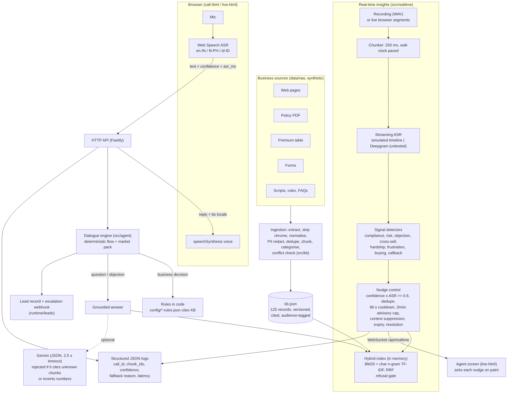

# Architecture

One Node.js process serves everything: ingestion, retrieval, the three voice bots, and the real-time nudge pipeline. They share one knowledge base and one retrieval function. At this scale that is the simplest shape that works. `scaling-and-cost.md` covers where it would split.

## Request path for one voice turn

1. The browser recognises the caller's speech and POSTs `{text, asr_confidence, client_timing.asr_ms}` to `/api/calls/:id/turns`.
2. `session.takeTurn` hands the turn to `dialogue.handleTurn` with the market pack. The engine checks the following in this order:
   1. silence or unclear audio
   2. do-not-call
   3. escalation request
   4. the consent or identity question
   5. a pending conflict confirmation
   6. objection
   7. slot answers
   8. "don't know"
   9. question
3. Questions and objections go to `answer.answerQuestion`. This retrieves from the KB: customer-facing records for questions, the objection category for objections.
   - If the answer is below the confidence gate, the bot says it does not have the information. Two such misses lead to a human.
   - If Gemini is configured, it phrases the answer from the retrieved passages and must cite their IDs. Otherwise the bot speaks the source sentences (extractive).
4. When every slot is filled, the pack's `decide()` applies the business rules in code and picks the closing line. `actions.recordLead` writes the lead JSON and fires the escalation webhook if needed.
5. The transcript, with chunk IDs per turn, is written to `runtime/calls/<id>.json` after PII masking.

A turn takes about 10 function calls from HTTP to reply. `dialogue.ts` is the only file with control flow worth reading closely.

## Latency budget (voice turn)

The targets were set before building. The measured column comes from `evidence/q1/latency.md`.

| Hop | Target | Measured | Note |
|---|---|---|---|
| ASR (end of speech to final text) | 600 ms | not measured | Happens in the browser. It needs a real call: the page records `asr_ms` per turn. |
| Understanding + rules | 20 ms | p95 1.6 ms (86 turns) | |
| Retrieval | 50 ms | p95 6.8 ms (12 turns) | The index is built once at boot (about 80 ms). |
| LLM grounded answer | 800 ms | not measured | No route to Google from the build sandbox. The 2.5 s timeout falls back to extractive. |
| TTS start | 300 ms | not measured | Browser voice. Recorded per turn as `tts_start_ms`. |
| **Total** | **under 1.8 s** | server side p95 3.3 ms | ASR, LLM and TTS dominate, and are the unmeasured part. |

## Latency budget (nudge)

| Hop | Target | Measured (`evidence/q4/latency.md`, 16 nudges, 1x real time) |
|---|---|---|
| Audio received to transcript | 300 ms (real ASR) | about 0 ms. SIMULATED: no recognition happens. |
| Signal extraction | 50 ms | p95 2 ms |
| KB grounding | 50 ms | p95 2 ms |
| LLM (optional) | 800 ms timeout | off by default. With an unreachable LLM, it fails in 12 to 77 ms and the template is used (`evidence/q4/llm_unavailable_fallback.log`). |
| Delivery (WebSocket) | 100 ms | p95 2 ms (same host) |
| End to end | under 2 s with real ASR | p95 5 ms without recognition |

## Failure modes

| Component | What breaks | How it is detected | What the caller or agent experiences |
|---|---|---|---|
| Speech recognition | No result, error, or low confidence | `onerror` and `confidence < 0.45` | "Sorry, I didn't catch that." After 3 in a row, transfer to a human. |
| Caller silence | No speech for 8 s | Page timer, `no-speech` | "Are you still there?" After 2, the call ends with a callback. |
| Retrieval | Nothing relevant | Cosine of the top chunk below 0.20 | "I don't have that information; I can connect you to an advisor." After 2, transfer (Rule Q6). |
| LLM | Timeout, HTTP error, bad JSON, unknown citation, invented number | `checkLlmAnswer`, AbortController | The extractive answer from the same chunk. The `llm_error` is logged. |
| LLM says the context does not answer | Semantic miss behind a lexical match | `answerable: false` in JSON | Treated as a refusal, not an answer. |
| Business rule data | Rule values drift from the KB | `tests/agent.test.ts` drift guard | The build fails, not the call. |
| Escalation webhook | Endpoint down | `fetch` error with a 3 s timeout | The transfer still happens. The failure is logged. |
| Real-time recogniser | Slow or no transcript | No segments arrive | No nudges. The call itself is unaffected (nudges are advisory). |
| Nudge LLM | Slow or failing | 800 ms timeout | The template text is used, and the nudge is still delivered. |
| WebSocket | Agent page disconnects | `close` event | The replay is aborted server-side. The page shows "Disconnected"; replay again to reconnect. |
| Browser has no voice for the locale | No `fil-PH` voice installed | `getVoices()` | The default voice is used, and the page says so. |
